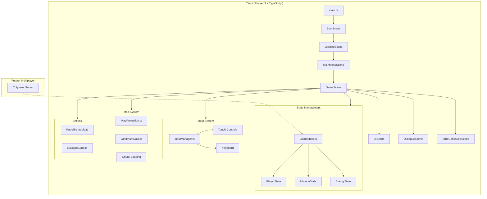

# Nile Grid

> Egyptian cyberpunk action/stealth/puzzle game set in Egypt, 2077

A 2D pixel-art mobile-first game playable in the browser as a PWA. The first playable build covers **Ismailia missions 1–3**: the railway station checkpoint, Hay el-Afrang patrol schedule, and de Lesseps House / canal museum with Bridge 3 crossing.

## Quick Start

```bash
# Install dependencies
npm install

# Run development server
npm run dev

# Build for production
npm run build

# Run tests
npm test

# Run E2E tests
npm run test:e2e

# Type check
npm run typecheck

# Lint
npm run lint
```

## Controls

### Desktop (Keyboard)
- **Arrow Keys / WASD**: Move
- **Shift**: Sprint
- **Space**: Interact / Action
- **Tab**: Switch character
- **E**: Interact with objects
- **Esc**: Pause

### Mobile (Touch)
- **Left side**: Virtual joystick (drag to move, outer edge to sprint)
- **A button**: Interact / Action
- **⇄ button**: Switch character

## Architecture



## Project Structure

```
src/
├── main.ts                 # Game entry point
├── config/
│   └── GameConfig.ts       # Game constants and character stats
├── state/
│   └── GameState.ts        # Central state management (multiplayer-ready)
├── input/
│   └── InputManager.ts     # Touch + keyboard input handling
├── map/
│   ├── MapProjection.ts    # Geo coordinate → pixel conversion
│   └── LandmarkData.ts     # Ismailia landmarks from real coordinates
├── entities/
│   └── PatrolSchedule.ts   # Enemy patrol routes and detection
├── dialogue/
│   └── DialogueData.ts     # Mission dialogue (Arabic + English)
├── assets/
│   └── PlaceholderAssets.ts # Procedural sprite generation
└── scenes/
    ├── BootScene.ts        # Initial boot
    ├── LoadingScene.ts     # Asset loading with Nile Neon theme
    ├── MainMenuScene.ts    # Title screen
    ├── GameScene.ts        # Core gameplay
    ├── UIScene.ts          # HUD overlay
    ├── DialogueScene.ts    # Speech bubbles and portrait box
    └── ToBeContinuedScene.ts # End of missions 1-3

docs/                       # Design documentation
├── 01-overview.md         # Vision and principles
├── 02-tech-stack.md       # Tech decisions
├── 03-art-pipeline.md     # Pixel art workflow
├── 04-multiplayer-and-hosting.md
├── 05-ux-and-loading.md   # Server wake, loading screen
├── 06-roadmap.md          # Development phases
├── 09-ismailia-map.md     # Map scale, landmarks
├── 10-storyline.md        # Nile Grid narrative
├── 11-chapter-ismailia.md # Mission design
├── 12-characters.md       # Crew personas and stats
├── 13-dialogue.md         # Dialogue system and samples
└── 14-ending-cutscene.md  # Victory sequence

maps/ismailia/
├── landmarks.json         # Real coordinates of landmarks
├── features.geojson       # OSM geometry
└── refs/                  # Reference photos
```

## Technical Decisions

| Aspect | Decision |
|--------|----------|
| Engine | Phaser 3 |
| Language | TypeScript |
| Bundler | Vite |
| View | 2D top-down (3/4) |
| Tile size | 16px |
| Character sprites | 24×32px |
| Map scale | ~3.5m per tile |
| Map size | ~1500×800 tiles |

## What's Placeholder

- **Sprites**: Procedurally generated colored rectangles. Production art should follow the Nile Neon concept sheets in `concepts/05-nile-neon.png`.
- **Map tiles**: Basic colored blocks. Need proper Tiled tilemap with chunked loading.
- **Portraits**: Colored squares with simple face features. Need 64×64 pixel art.
- **Audio**: None implemented. Needs ambient sound and simsimiyya-inspired music.
- **Enemy AI**: Basic patrol loops. Needs line-of-sight, alert escalation.
- **Puzzles**: Interaction zones only. Needs minigame mechanics.

## Missions Implemented

### Mission 1: Railway Station & Orabi Square
- Reach the station forecourt
- Loop the cameras (requires Laila)
- Cross to the south alley undetected

### Mission 2: Hay el-Afrang
- Reach Gumhuriya Square
- Copy the patrol schedule (requires Laila)
- Cross the quarter without alarm

### Mission 3: The Quay & Bridge 3
- Retrieve the override token from de Lesseps House (requires Nour)
- Decrypt the token at the Canal Museum (requires Laila)
- Repair Bridge 3 (requires Adel)
- Cross the Sweet-Water Canal

## Characters

| Name | Role | Speed | Health | Stealth | Hacking | Combat | Support |
|------|------|-------|--------|---------|---------|--------|---------|
| Nour Hassan | Courier | 5 | 2 | 4 | 2 | 3 | 1 |
| Adel Mansour | Mechanic | 2 | 5 | 2 | 2 | 4 | 5 |
| Laila Farouk | Hacker | 3 | 2 | 4 | 5 | 2 | 2 |

## Development Notes

### State Management
The `GameState` class is designed as a singleton with subscription-based updates, making it ready for future Colyseus multiplayer integration. Game logic is separated from rendering.

### Map Projection
Real geographic coordinates from `landmarks.json` are projected to game pixels using local equirectangular projection. The origin is Abdel Moneim Riad Square.

### Dialogue System
- **Bubbles**: Non-blocking speech above characters during gameplay
- **Portrait box**: Bottom dialogue with 64×64 portrait for key story scenes
- All dialogue has both Arabic (`textAr`) and English (`textEn`) versions

### Multiplayer-Ready Architecture
- Simulation state is tick-based and serializable
- Input is processed through a unified InputManager
- Camera follows only the local player (ready for per-player cameras)
- Enemy positions update server-side (stubbed for Colyseus)

## License

All code is provided for review. See individual asset sources in `maps/ismailia/refs/SOURCES.json` for attribution requirements.

## Credits

- Map data: © OpenStreetMap contributors (ODbL)
- Design documentation and concept: Based on the Nile Neon direction
- Landmark coordinates: Wikidata, Wikivoyage
