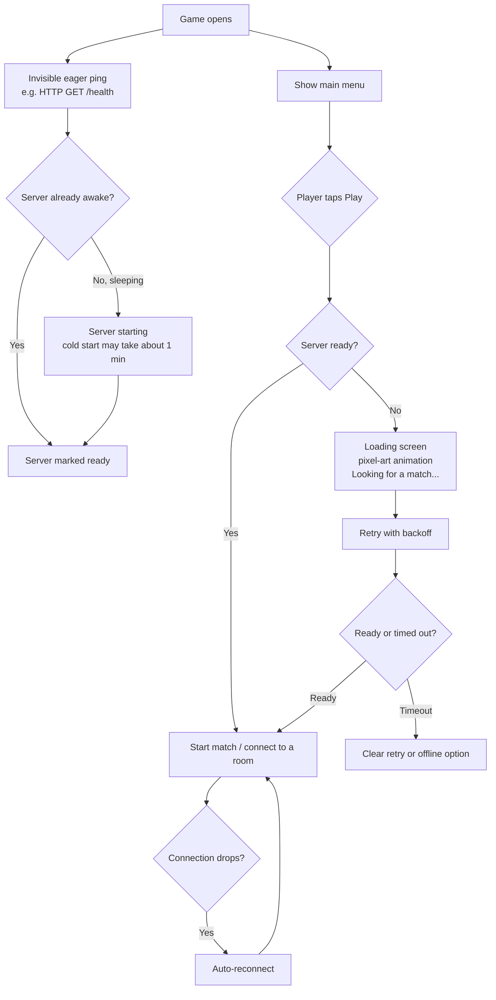

# 05 — UX: eager wake, loading screen, reconnect, camera, and map streaming

These rules exist because the first multiplayer host may be **Render’s free tier**, which **sleeps after 15 minutes of inactivity** and can take **about a minute** to become reachable again. Even after the host changes, the same UX is useful for slow networks and dropped mobile connections.

## 1. Eager server wake

As soon as the game finishes its own boot and reaches the **main menu**, the client should ping the Colyseus (or health) endpoint in the background.

- The player is not blocked. They can read how to play, tweak audio, or wait on the menu.
- By the time they tap **Play / Find match**, the instance will often already be warm.
- The ping must be cheap (HTTP health check or a lightweight WebSocket hello) and safe to retry.

Single-player modes must not wait on this ping. They start instantly, including offline.

## 2. Loading screen if the server is still cold

If the player asks for an online match and the server is not ready yet:

- Show a **short, looping pixel-art animation** in the same art style as the game (idle fidget, a lantern, a scarab, a charging battery — tied to the chosen theme).
- Use a friendly status line such as “Looking for a match…” or “Waking the server…”, not a black screen, a blank spinner, or a technical error.
- Set a timeout. If the server never comes up, explain that online play is unavailable and offer **Play offline**.
- Keep the animation small and looping; do not stream a large video.

This screen is a planned art deliverable in the Nile Neon style, drawn for the 2D top-down (3/4) view. It is not in the first five roster sheets.

## 3. Automatic reconnect

Mobile networks drop. So do deploys and host restarts.

- If the socket closes mid-menu or mid-queue, retry with backoff and keep the player on a “Reconnecting…” state.
- If the socket closes mid-match, try to rejoin the same Colyseus room for a short window.
- If rejoin fails, explain the disconnect and return to the menu. Do not freeze on the last frame with no explanation.
- A host restart during a match will still dump players; the client should recover to a known screen.

## 4. Camera and minimap

Decided on 2026-11-27:

- Each player's camera is **client-side and independent**. It follows **only their own character**.
- In multiplayer, the player sees **nearby players** in their own view; they do not share a camera with anyone else.
- A **minimap** is required. The Ismailia map is large (~1500 × ~800 tiles, about five minutes to walk west–east), so the player needs a way to orient themselves and find landmarks. Exact minimap art and features (fog of war, landmark pins, and so on) are not decided yet.

## 5. Chunked map loading

The decided map scale makes a single Tiled layer too large to load in one piece on a phone (~24 000 × 12 800 px at 16 px/tile).

- Split the Tiled map into **chunks**.
- **Load chunks near the player** (and unload chunks that are far away).
- Streaming should be quiet during normal movement: do not block the player behind a full-screen loader for every new chunk if it can be avoided.
- The first visit to a slice, or a teleport to an unloaded area, may still need a brief wait; reuse the same pixel-art loading language as the server-wake screen if a wait is unavoidable.
- Exact chunk size, preload radius, and unload distance are **not decided yet**. Tune them on a phone.

Details of the scale itself are in [09-ismailia-map.md](09-ismailia-map.md).

## 6. What this does not fix

Eager wake does **not** remove the first-visitor delay if nobody has opened the game for 15 minutes and the player taps Play immediately. It only hides the delay most of the time.

Free-tier CPU/RAM limits, region ping, and disconnects on deploy are separate issues. They are why a non-sleeping host is recommended before a public multiplayer launch (see [04-multiplayer-and-hosting.md](04-multiplayer-and-hosting.md)).

## 7. Dialogue on screen

**Decided (2026-11-27):** a **hybrid** presentation. Details and writing rules are in [13-dialogue.md](13-dialogue.md).

- **Speech bubbles** above the speaker for short ambient lines and crew or NPC banter during play. These are **non-blocking**.
- **A bottom dialogue box** with a **64×64 px pixel-art portrait** (with facial expressions) and the **speaker’s name**, only for key story scenes.
- **Multiplayer:** the dialogue box appears **only for the player who triggered** it. Other players see a **small dialogue icon** above that character. The game **never pauses** for the others. Each player’s camera stays on their own character.

## Flow

Exact retry intervals and the timeout are not decided yet. Tune them against a real cold start (about one minute on Render's free tier).
